<div align="center">

# plainframe-skill

用代码做中文科普短视频

写一段文案，跑几条命令，得到一条 16:9 的成片

[](#)
[](#)
[](#能做出什么)
[](#)

</div>

不打开剪辑软件。画面是网页，动画是时间线，配音（可选）、混音、渲染都在脚本里完成。

---

## 能做出什么

18 套风格，每套是一个能跑起来的 5 秒样例，`hyperframes lint` 全部通过。下面是各自的第 3 秒：

<table>
<tr>
<td width="33%" align="center" valign="top">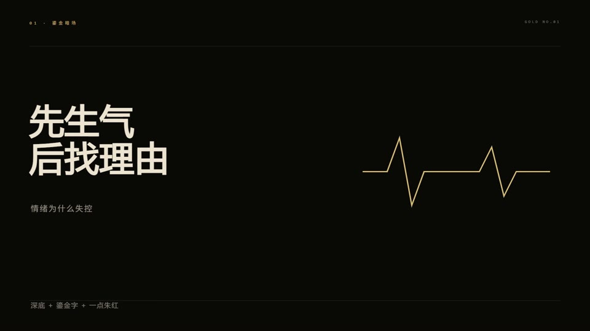
<sub><b>01</b> 鎏金暗场 · 人文 / 历史 / 情绪</sub></td>
<td width="33%" align="center" valign="top">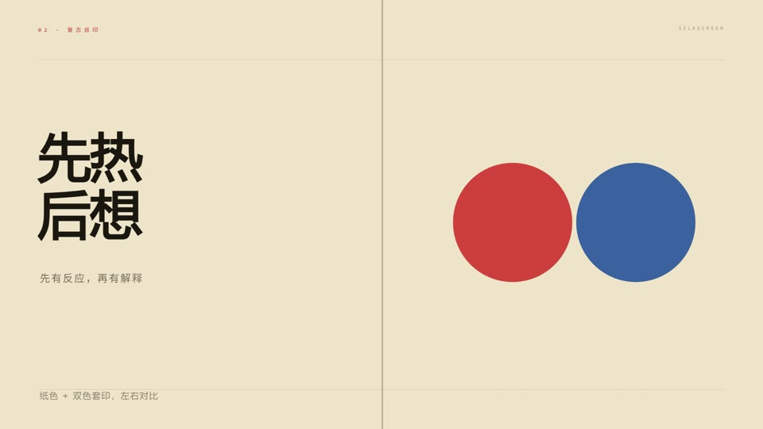
<sub><b>02</b> 复古丝印 · 观点 / 反常识</sub></td>
<td width="33%" align="center" valign="top">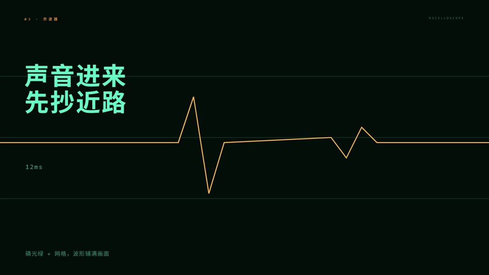
<sub><b>03</b> 示波器 · 机制 / 数据 / 时间尺度</sub></td>
</tr>
<tr>
<td width="33%" align="center" valign="top">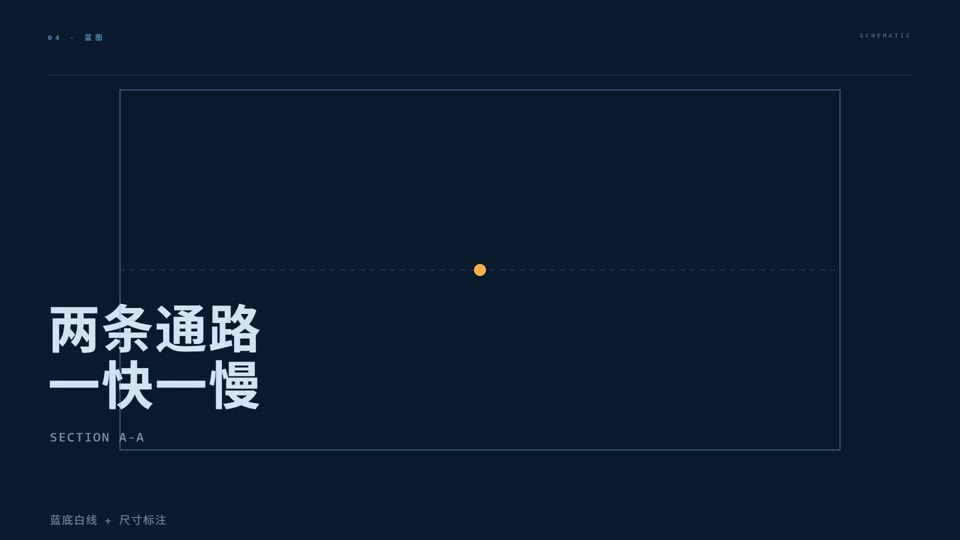
<sub><b>04</b> 蓝图 · 结构 / 流程 / 装置</sub></td>
<td width="33%" align="center" valign="top">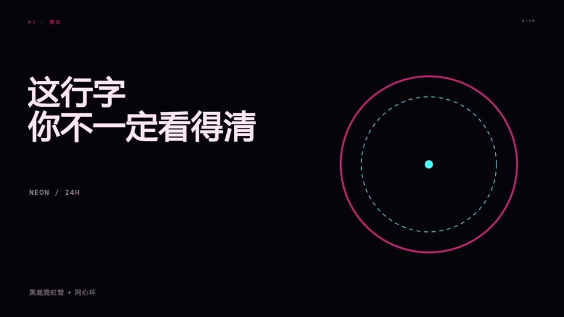
<sub><b>05</b> 霓虹 · 年轻向 / 网络现象</sub></td>
<td width="33%" align="center" valign="top">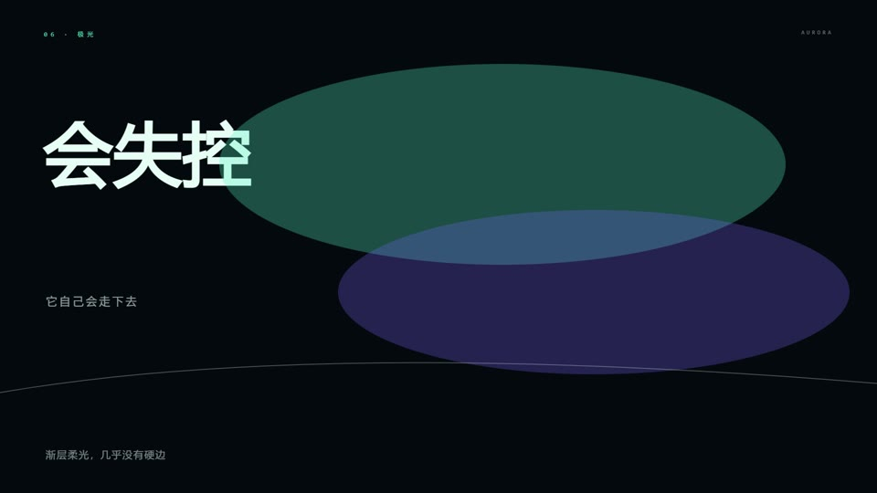
<sub><b>06</b> 极光 · 抽象 / 氛围 / 宇宙</sub></td>
</tr>
<tr>
<td width="33%" align="center" valign="top">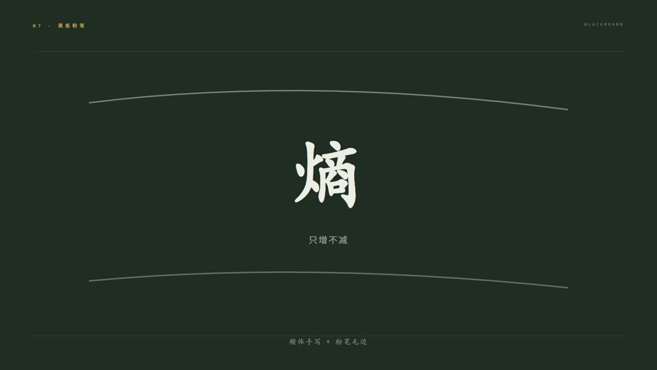
<sub><b>07</b> 黑板粉笔 · 教学 / 推导 / 汉字</sub></td>
<td width="33%" align="center" valign="top">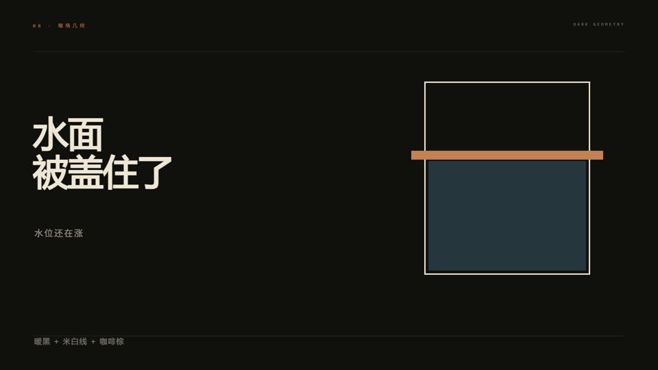
<sub><b>08</b> 暗场几何 · 机制 / 隐喻</sub></td>
<td width="33%" align="center" valign="top">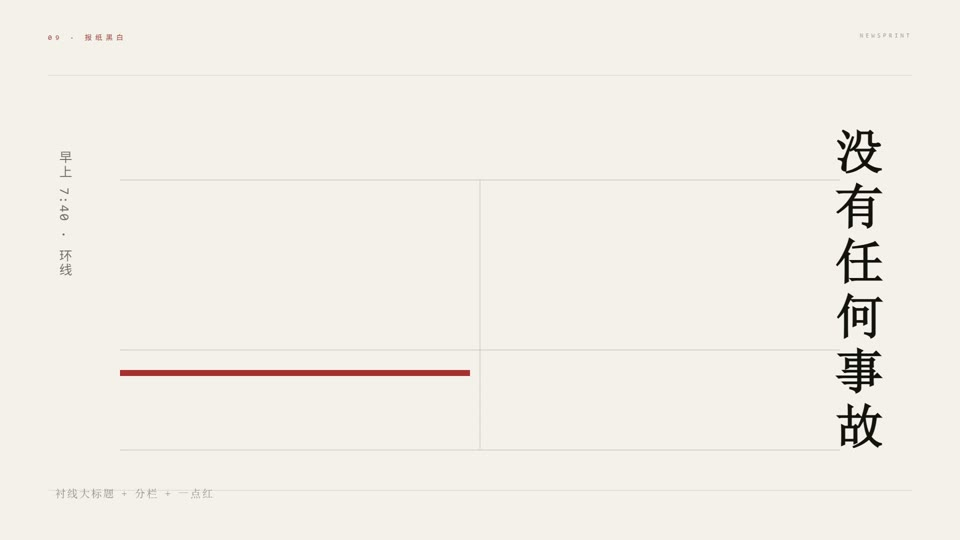
<sub><b>09</b> 报纸黑白 · 调查 / 事实</sub></td>
</tr>
<tr>
<td width="33%" align="center" valign="top">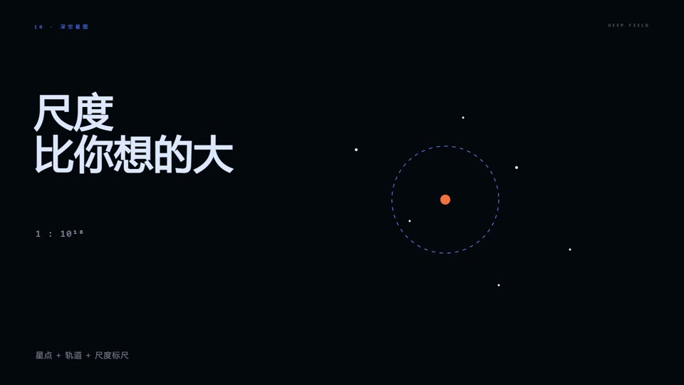
<sub><b>10</b> 深空星图 · 概率 / 尺度</sub></td>
<td width="33%" align="center" valign="top">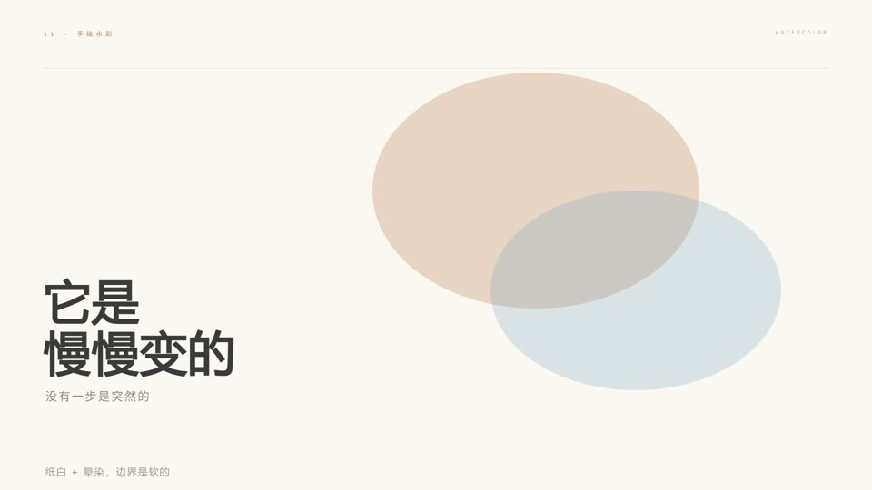
<sub><b>11</b> 手绘水彩 · 自然 / 生物</sub></td>
<td width="33%" align="center" valign="top">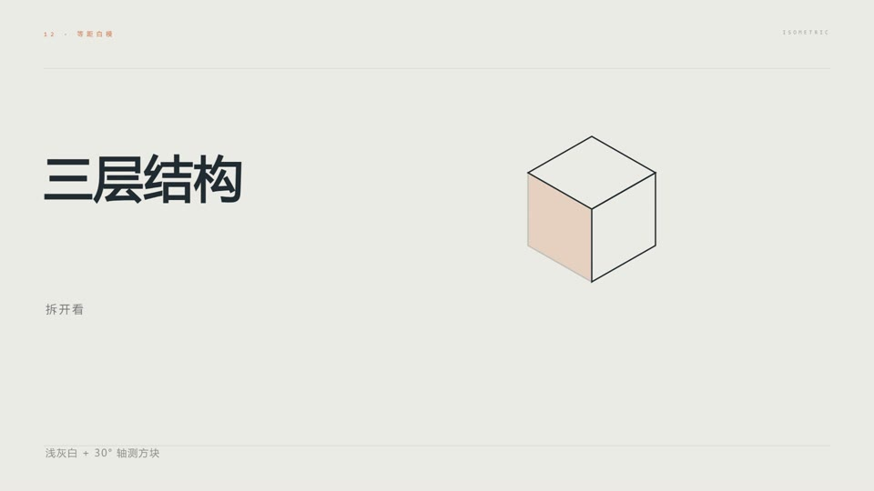
<sub><b>12</b> 等距白模 · 原理 / 装置</sub></td>
</tr>
<tr>
<td width="33%" align="center" valign="top">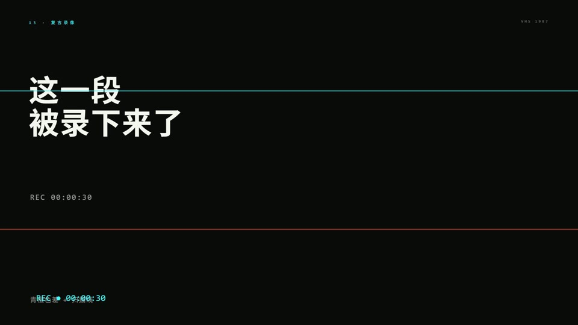
<sub><b>13</b> 复古录像 · 影像 / 记忆 / 往事</sub></td>
<td width="33%" align="center" valign="top">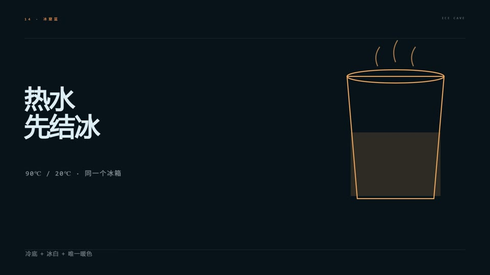
<sub><b>14</b> 冰窟蓝 · 冷 / 实验</sub></td>
<td width="33%" align="center" valign="top">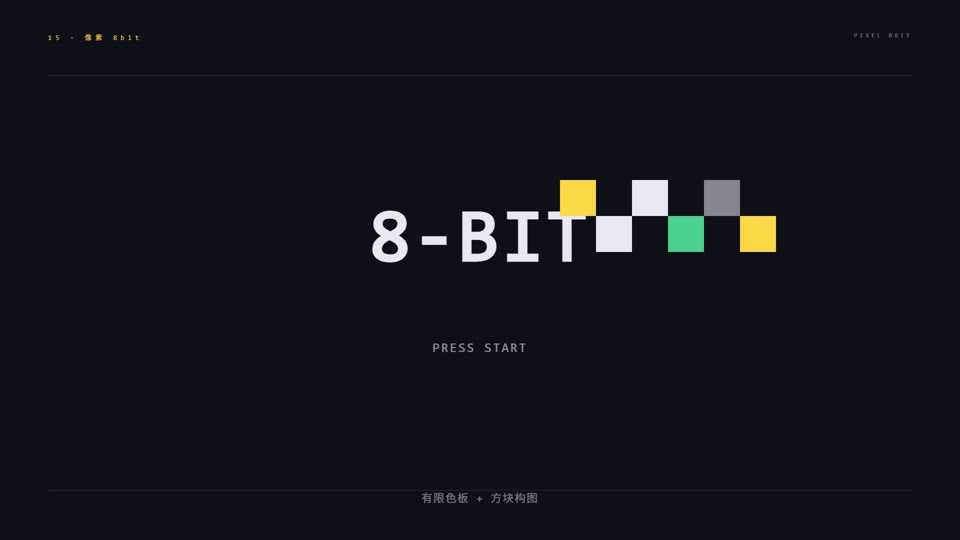
<sub><b>15</b> 像素 8bit · 游戏 / 算法</sub></td>
</tr>
<tr>
<td width="33%" align="center" valign="top">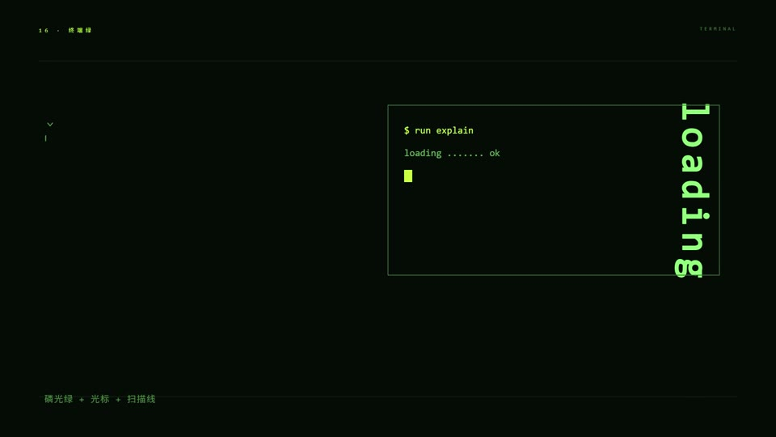
<sub><b>16</b> 终端绿 · 代码 / 协议 / 命令行</sub></td>
<td width="33%" align="center" valign="top">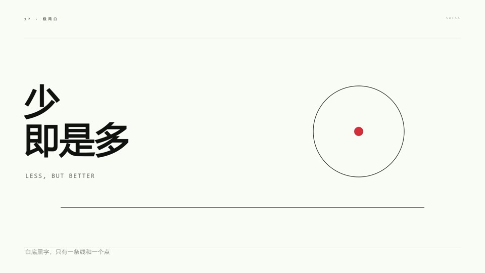
<sub><b>17</b> 极简白 · 概念 / 定义 / 对照</sub></td>
<td width="33%" align="center" valign="top">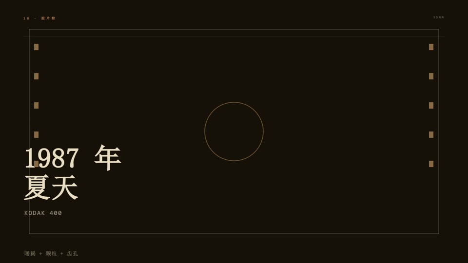
<sub><b>18</b> 胶片棕 · 人物 / 年代 / 档案</sub></td>
</tr>
</table>

不是同一版式换颜色：18 套分六种构图骨架（左文右图 / 居中 / 底文 / 竖排 / 全屏图形 / 分栏），各有母题和示例文案。完整的色值、字体、图形与动效语汇见 [`docs/流程/风格库.md`](docs/流程/风格库.md)。

---

## 一条片子长什么样

60 秒为例：

- **20–24 句**文案，每句 2–4 秒，一句一行写进 `lines.json`；
- **10–16 场**，每场一个主装置，不重复；
- 每句一张字幕、一个动作，说完就撤；
- BGM 跟着人声自动闪避 35%。

顺序是反的：**先定声音，再倒推时间线**。口播版按每句音频的真实时长算，无口播版按字数（4.2 字/秒）或拍表算。改一句文案重跑 `build.py`，卡点、字幕、动效一起对齐——改稿两分钟，不是一晚上。

---

## 快速开始

```bash
# 0. 起一个 hyperframes 工程，把脚手架拷进去
npx hyperframes init my-video && cd my-video
cp -r <repo>/templates/* .

# 1. 改 lines.json：一句一行，可标 "nosub": true 不上字幕
# 2. 出声（仅口播版，先 npm i msedge-tts；无口播跳过这步）
node gen_tts.mjs ./_tts

# 3. 排时间线 → 生成 index.html（字幕、总时长、逐句动效都在这一步定型）
python build.py ./_tts .
#    无口播版：python build.py . . --novoice

# 4. 混音：合成 BGM + 叠人声 + 闪避
python synth_bgm.py
python mix.py ./_tts .

# 5. 出片
npx hyperframes render -o silent.mp4
ffmpeg -y -i silent.mp4 -i mix.wav -c:v libx264 -crf 21 -preset medium \
       -pix_fmt yuv420p -c:a aac -b:a 192k -ar 48000 -shortest out.mp4
```

前四步都是秒级，渲染看画面复杂度，一般一分钟上下。

渲染前要指定浏览器。系统 Chrome 经常不稳，建议单独下一个 chrome-headless-shell：

```powershell
$env:HYPERFRAMES_BROWSER_PATH = "<chrome-headless-shell 路径>"
```

---

## 两条路线

| | A 口播版 | B 无口播版 |
|---|---|---|
| 文案 | 20–24 句说出来的话 | 30–45 句读的字幕，一句 ≤14 字 |
| 时长 | 按音频实测 | 按字数估，或按拍表 |
| 音频 | 人声 + BGM 闪避 | 只有 BGM |
| 命令 | `python build.py ./_tts .` | `python build.py . . --novoice` |

配套三个工具：

```bash
python tools/beats.py beats.json --bpm 100      # 拍表 → 时间线
python tools/contact_sheet.py out.mp4 -n 12     # 抽帧接触表（--at 3,15,27 指定秒数）
python tools/qa.py out.mp4                      # 自检：规格 / 黑屏 / 静止超过 2 秒
```

`contact_sheet.py` 默认把接触表落在**当前目录**，不落在成片旁边——成品文件夹只该放成片。

---

## 目录

```
plainframe-skill/
├── SKILL.md              主文档：工作流、动效引擎、文字规则、锚词、踩坑
├── MEMORY.md             一页规则（新会话先读）
├── CHECKLIST.md          出片前逐项检查
├── skill.json            版本、依赖、各平台接入方式
├── dist/                 单文件版（喂给模型用）
├── docs/                 规则文档，索引见 docs/README.md
│   ├── 流程/             母版与流程、花叔设计法、锚词与重拍、风格库
│   ├── 发布/             发布包（标题 / 话题 / 封面 / 配文）、插件打包
│   └── 参考/             参考拆解、七个仓库、与 vibe-169 的边界
├── styles/               18 套可运行样例
├── previews/             18 张预览图
├── templates/            骨架、构建、配音（可选）、混音、BGM
├── tools/                拍表、抽帧接触表、自检
└── _tools/               生成风格、打包单文件、查断链
```

---

## 接入方式

| 平台 | 怎么装 |
|---|---|
| 豆包（本地电脑模式） | 整个文件夹放进工作区，让 Agent 读 `SKILL.md` |
| DeepSeek | 上传 `dist/plainframe-all.md` |
| WorkBuddy | 放进 `skills/plainframe-skill/` |
| Qoder | 放进 `.qoder/skills/`，或直接 `@SKILL.md` |

`dist/plainframe-all.md` 是单文件版，主文档、检查清单、模板源码、风格库、附录规则全在里面，跑 `python _tools/bundle.py` 重新生成。

---

## 适合与不适合

**适合**：愿意写一点 HTML 和 GSAP，想批量产出、频繁改稿的科普内容。

**不适合**：完全不想碰代码；或者需要实拍、真人、复杂三维的片子。

## 依赖

Node.js 22 以上、FFmpeg、hyperframes CLI、Python 的 numpy 与 Pillow、chrome-headless-shell。
口播版另需 `msedge-tts`（无口播版不需要）。

---

做片之前先扫一眼 `MEMORY.md` 和 `SKILL.md` 第八节的踩坑清单——SVG 用 `transformOrigin` 会飞出画面、`fromTo` 的起始值会提前生效、两场交叉淡入会出现双重残影，这三个能省一晚上。
