<div align="center">

# plainframe-skill

用代码做中文科普短视频

写一段口播文案，跑几条命令，得到一条 16:9 的成片

[](#)
[](#)
[](#风格)
[](#)

</div>

不打开剪辑软件。画面是网页，动画是时间线，配音（可选）和渲染都在脚本里完成。

---

## 一条片子长什么样

以 60 秒为例：

- 20–30 句口播，每句 2–4 秒
- 10–16 场，每场一个图形，不重复
- 每句一张字幕、一个动作，说完就撤
- 背景音乐跟着人声自动闪避

你在 `lines.json` 里写的就是那 20–30 句。场次由文案自动分组，动作按句子顺序排。

---

## 为什么反过来做

一条 60 秒的片子有 20 多句台词，每句要卡字幕、动作、停顿。手动拖时间轴，改一句就要重排一次。

所以这里把顺序换了：**先定声音，再倒推时间线**。
口播版按每句音频的真实时长算；无口播版按字数（4.2 字/秒）或拍表算。改文案只要重跑 `build.py`，卡点、字幕、动效一起重新对齐。

代价是前期要把画面写成 HTML。好处是改一次文案只要两分钟，而不是一晚上。

---

## 流程

| 步骤 | 命令 | 产出 |
|---|---|---|
| 1. 写文案 | 编辑 `lines.json` | 一句一行，可标 `nosub` |
| 2. 出声 | `node gen_tts.mjs`（口播）或跳过（无口播） | 每句一个 24k wav，或直接按字数算 |
| 3. 排时间线 | `python build.py` | 生成 `index.html`，含字幕与总时长 |
| 4. 混音 | `python synth_bgm.py` + `python mix.py` | 人声 + BGM，自动闪避 |
| 5. 出片 | `npx hyperframes render` | 无声画面，ffmpeg 合轨 |

前四步都是秒级，渲染视画面复杂度在 1 分钟左右。

---


## 预览

18 套风格，各自有自己的构图和文案：

<table>
<tr>
<td width="33%" align="center" valign="top">
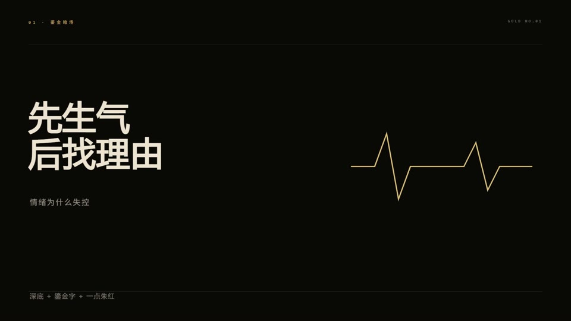

<sub><b>01</b> 鎏金暗场</sub>
</td>
<td width="33%" align="center" valign="top">
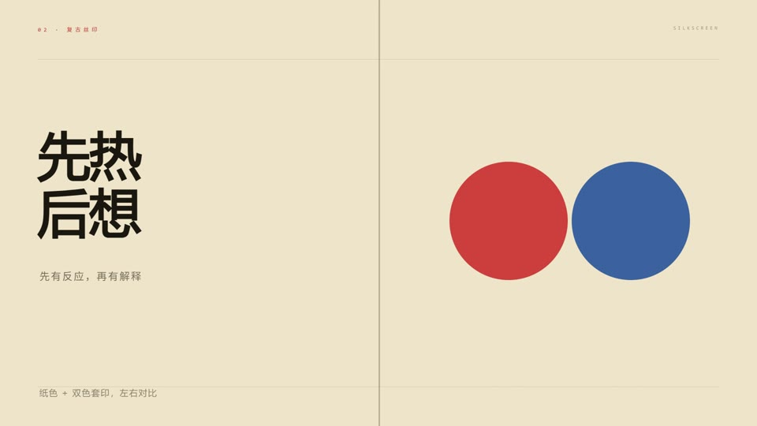

<sub><b>02</b> 复古丝印</sub>
</td>
<td width="33%" align="center" valign="top">
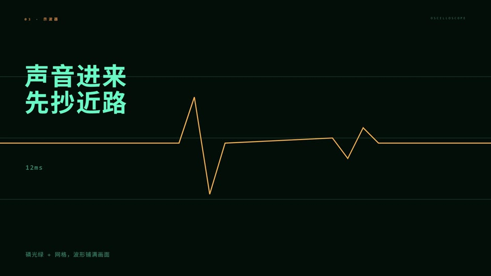

<sub><b>03</b> 示波器</sub>
</td>
</tr>
<tr>
<td width="33%" align="center" valign="top">
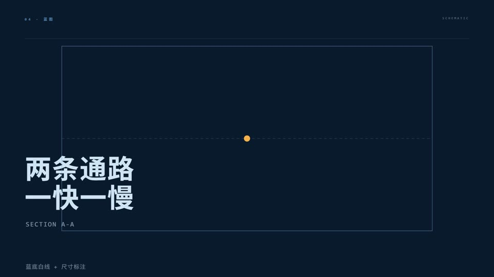

<sub><b>04</b> 蓝图</sub>
</td>
<td width="33%" align="center" valign="top">
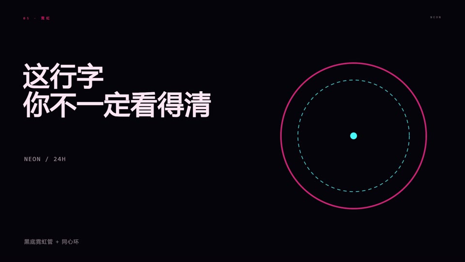

<sub><b>05</b> 霓虹</sub>
</td>
<td width="33%" align="center" valign="top">
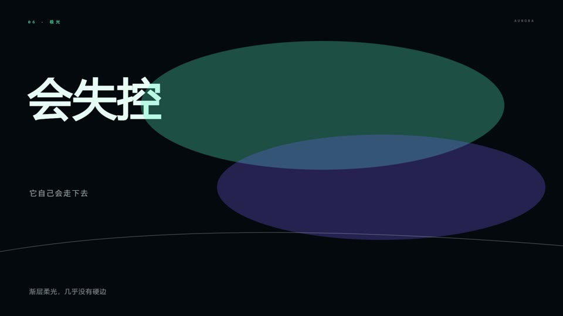

<sub><b>06</b> 极光</sub>
</td>
</tr>
<tr>
<td width="33%" align="center" valign="top">
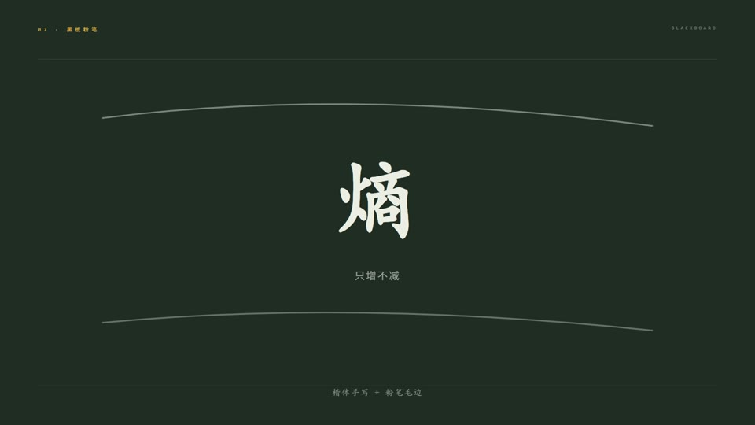

<sub><b>07</b> 黑板粉笔</sub>
</td>
<td width="33%" align="center" valign="top">
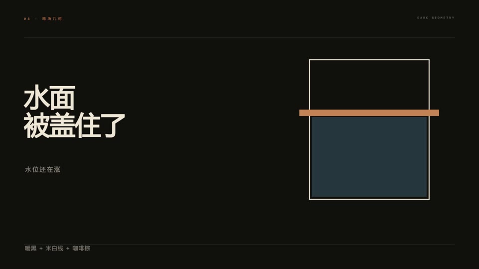

<sub><b>08</b> 暗场几何</sub>
</td>
<td width="33%" align="center" valign="top">
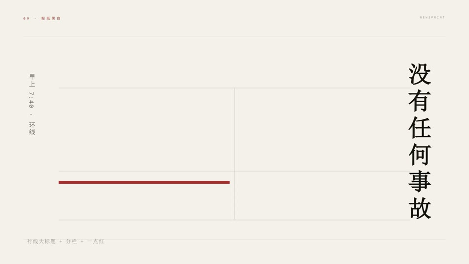

<sub><b>09</b> 报纸黑白</sub>
</td>
</tr>
<tr>
<td width="33%" align="center" valign="top">
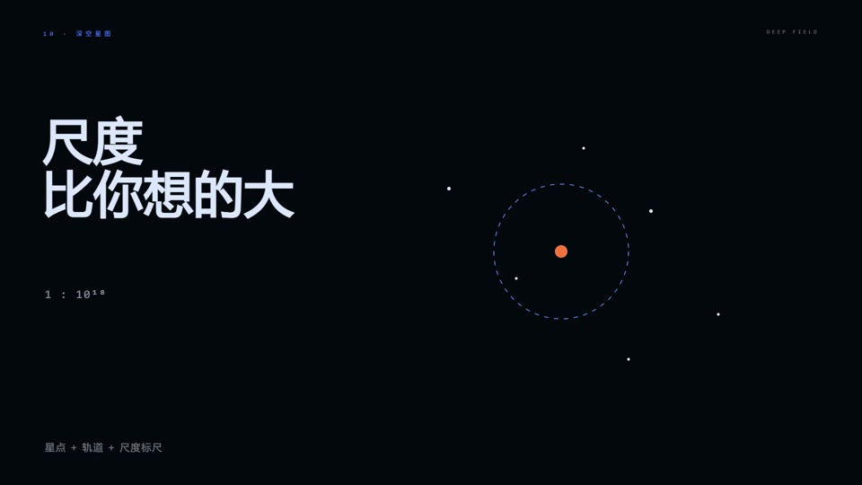

<sub><b>10</b> 深空星图</sub>
</td>
<td width="33%" align="center" valign="top">
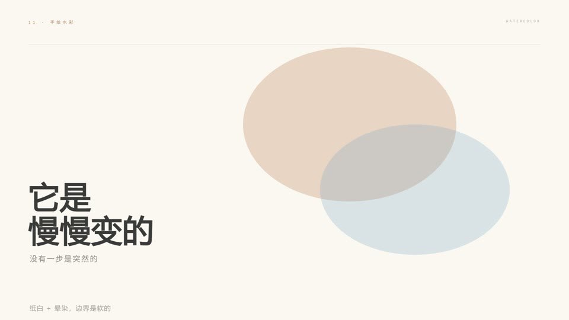

<sub><b>11</b> 手绘水彩</sub>
</td>
<td width="33%" align="center" valign="top">
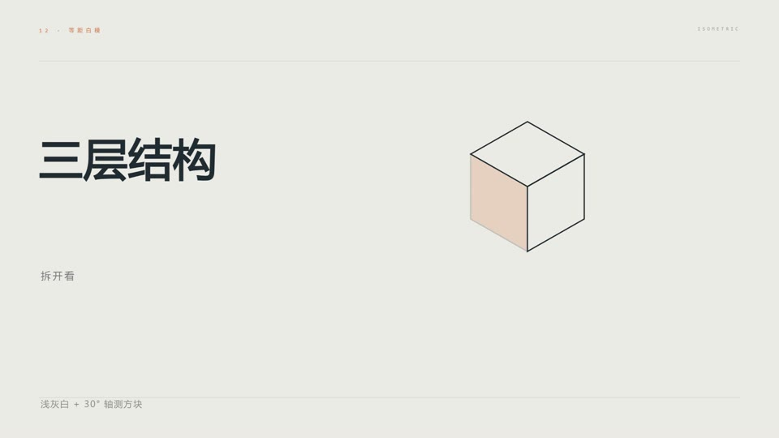

<sub><b>12</b> 等距白模</sub>
</td>
</tr>
<tr>
<td width="33%" align="center" valign="top">
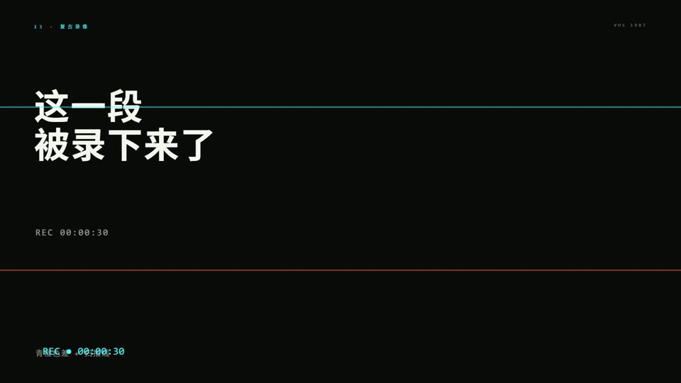

<sub><b>13</b> 复古录像</sub>
</td>
<td width="33%" align="center" valign="top">
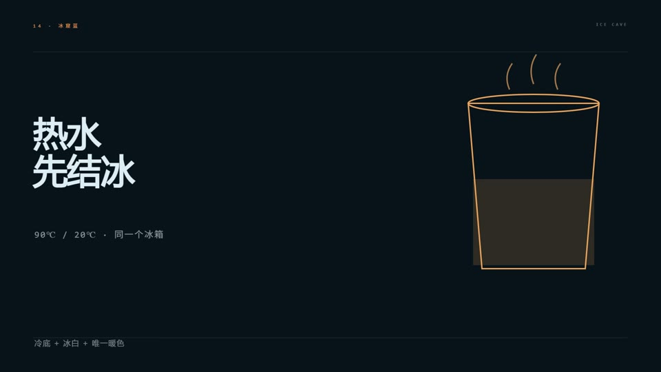

<sub><b>14</b> 冰窟蓝</sub>
</td>
<td width="33%" align="center" valign="top">
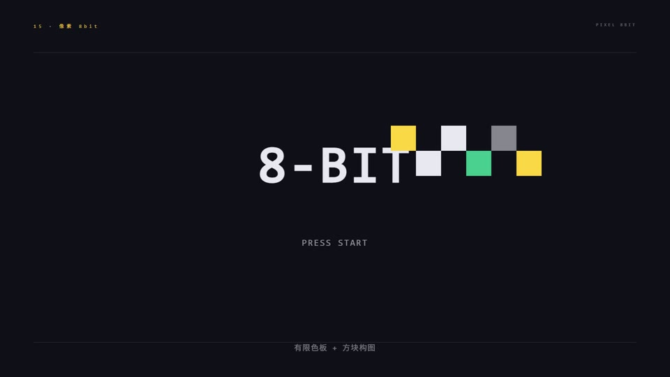

<sub><b>15</b> 像素 8bit</sub>
</td>
</tr>
<tr>
<td width="33%" align="center" valign="top">
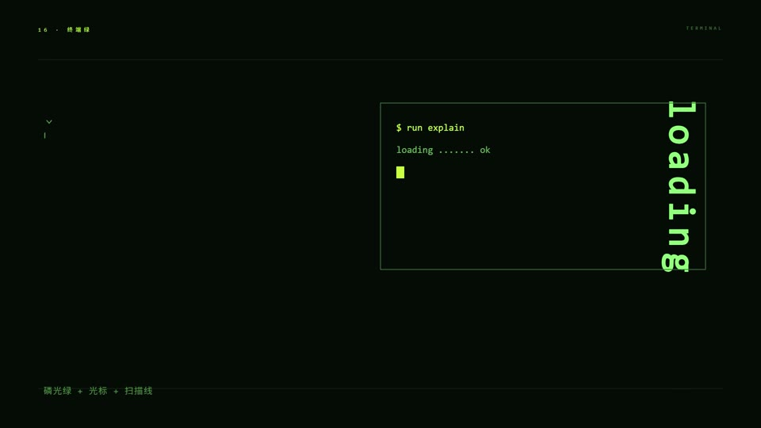

<sub><b>16</b> 终端绿</sub>
</td>
<td width="33%" align="center" valign="top">
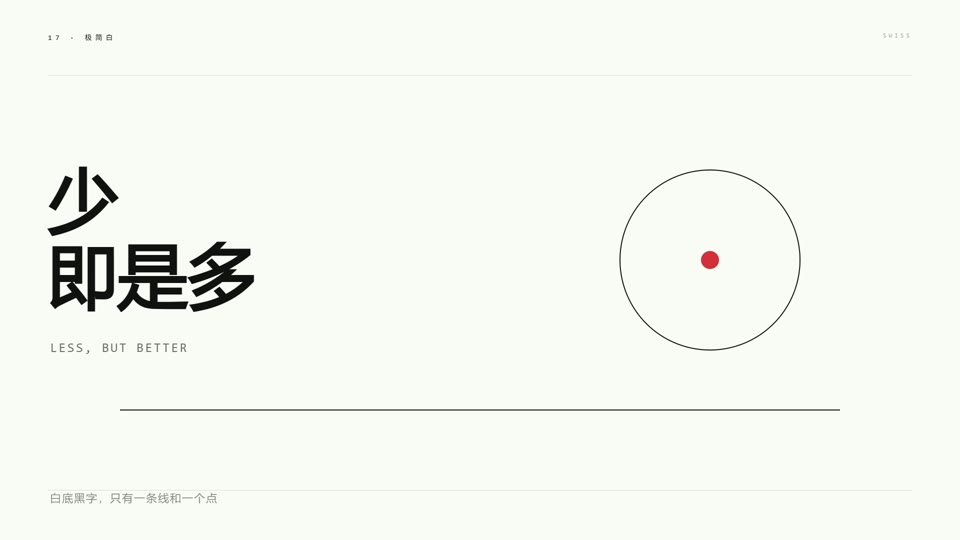

<sub><b>17</b> 极简白</sub>
</td>
<td width="33%" align="center" valign="top">
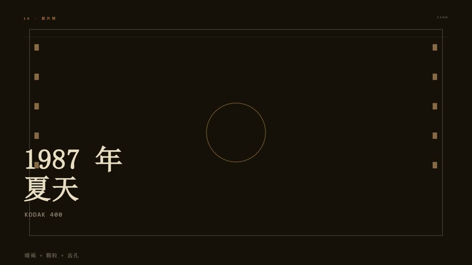

<sub><b>18</b> 胶片棕</sub>
</td>
</tr>
</table>

每张图都是 `styles/` 里对应文件渲染出来的第 3 秒。构图上分六种骨架（左文右图 / 居中 / 底文 / 竖排 / 全屏图形 / 分栏），不是同一版式换颜色。

---

## 风格

18 套配色，每套是 `styles/` 里一个可运行的 5 秒样例，`hyperframes lint` 全部通过。

换风格只改五个值：底色、主色、强调色、辅助色、母题形状。结构不用动。

| # | 名称 | 底色 | 主色 | 强调 | 适合 |
|---|---|---|---|---|---|
| 01 | 鎏金暗场 | `#0B0908` | `#DDBD74` | `#D9583C` | 人文、定律、情绪 |
| 02 | 复古丝印 | `#F0E3C8` | `#D63A2C` | `#184A9E` | 观点、反常识 |
| 03 | 示波器 | `#030C0A` | `#5FE8C8` | `#FFB347` | 机制、时间尺度 |
| 04 | 蓝图 | `#0A1A2E` | `#6FA8DC` | `#FFB347` | 结构、流程 |
| 05 | 霓虹 | `#07040C` | `#FF3D8B` | `#38E8FF` | 年轻向、网络 |
| 06 | 极光 | `#04080F` | `#46E0C0` | `#7C6BFF` | 抽象、氛围 |
| 07 | 黑板粉笔 | `#1E2A24` | `#EDEDE3` | `#F2C14E` | 教学、汉字、推导 |
| 08 | 暗场几何 | `#12100E` | `#EFE6D6` | `#C98553` | 隐喻、连续过程 |
| 09 | 报纸黑白 | `#F4F1EA` | `#15130F` | `#B03A2E` | 调查、事实 |
| 10 | 深空星图 | `#05070E` | `#DCE8FF` | `#4D8CFF` | 宇宙、概率 |
| 11 | 手绘水彩 | `#FBF8F1` | `#3A3A3A` | `#C98A5B` | 自然、生物 |
| 12 | 等距白模 | `#ECEAE4` | `#1F2A33` | `#E07A3F` | 原理、装置 |
| 13 | 复古录像 | `#0B0B0B` | `#F5F5F0` | `#38E8FF` | 影像、记忆 |
| 14 | 冰窟蓝 | `#08121A` | `#DCEBF5` | `#F2A65A` | 冷、实验、时间尺度 |
| 15 | 像素 8bit | `#101018` | `#E8E8F0` | `#FFD23F` | 游戏、算法、历史 |
| 16 | 终端绿 | `#070B07` | `#8CFF7A` | `#C8FF3D` | 代码、协议、命令行 |
| 17 | 极简白 | `#FAFAF7` | `#111111` | `#E03E36` | 概念、定义、对照 |
| 18 | 胶片棕 | `#171008` | `#EADCC0` | `#D89B5A` | 人物、年代、档案 |

---

## 两条路线

| | A 口播版 | B 无口播版 |
|---|---|---|
| 文案 | 20–30 句说出来的话 | 30–45 句读的字幕，一句 ≤14 字 |
| 时长 | 按音频实测 | 按字数估，或按拍表 |
| 音频 | 人声 + BGM 闪避 | 只有 BGM |
| 命令 | `python build.py ./_tts .` | `python build.py . . --novoice` |

配套三个工具：

```bash
python tools/beats.py beats.json --bpm 100   # 拍表 → 时间线
python tools/sheet.py out.mp4 --even 12      # 抽帧联系表
python tools/qa.py out.mp4                   # 自动自检
```

`qa.py` 会检查分辨率、音轨、黑屏，并报出所有「静止超过 2 秒」的段落。

## 快速开始

```bash
npx hyperframes init my-video && cd my-video
cp -r <repo>/templates/* .

# 先改 lines.json，把文案换成你自己的
# 口播版才需要：npm i msedge-tts
node gen_tts.mjs ./_tts
python build.py ./_tts .

python synth_bgm.py
python mix.py ./_tts .

npx hyperframes render -o silent.mp4
ffmpeg -i silent.mp4 -i mix.wav -shortest out.mp4
```

渲染前要指定浏览器。系统 Chrome 经常不稳，建议单独下一个 chrome-headless-shell：

```powershell
$env:HYPERFRAMES_BROWSER_PATH = "<chrome-headless-shell 路径>"
```

---

## 接入方式

| 平台 | 怎么装 |
|---|---|
| 豆包（本地电脑模式） | 整个文件夹放进工作区，让 Agent 读 `SKILL.md` |
| DeepSeek | 上传 `dist/plainframe-all.md` |
| WorkBuddy | 放进 `skills/plainframe-skill/` |
| Qoder | 放进 `.qoder/skills/`，或直接 `@SKILL.md` |

`dist/plainframe-all.md` 是单文件版，约 51 KB，主文档、检查清单、全部模板源码都在里面。跑一遍 `_tools/bundle.py` 就能重新生成。

---

## 目录

```
plainframe-skill/
├── SKILL.md              主文档：工作流、风格、动效引擎、文字规则、踩坑
├── MEMORY.md             一页规则（新会话先读）
├── CHECKLIST.md          出片前逐项检查
├── skill.json            版本、依赖、各平台接入方式
├── dist/                 单文件版
├── docs/发布文案.md        发布用的句式与结构模板
├── styles/               18 套可运行样例
├── templates/            骨架、构建、配音（可选）、混音、抽帧
└── _tools/               生成风格、打包单文件
```

---

## 适合与不适合

**适合**：愿意写一点 HTML 和 GSAP，想批量产出、频繁改稿的科普内容。

**不适合**：完全不想碰代码；或者需要实拍、真人、复杂三维的片子。

---

## 依赖

Node.js 22 以上、FFmpeg、hyperframes CLI、Python 的 numpy、chrome-headless-shell。
口播版另需 `msedge-tts`（无口播版不需要）。

---

`SKILL.md` 里记了这几个月踩过的坑，比如 SVG 用 `transformOrigin` 会飞出画面（要用 `svgOrigin`）、`fromTo` 的起始值会提前生效、两场交叉淡入淡出会出现双重残影。做片之前扫一眼能省不少时间。
